# POS Wan

**Logiciel de caisse et de gestion commerciale** pour les commerces du Niger (alimentations,
supermarchés, boutiques, pharmacies, restaurants et maquis, quincailleries, dépôts de boissons…),
en FCFA (devise modifiable), fonctionnant en local sur **WampServer** — sans Internet.
Interface en **français, anglais, arabe, haoussa, espagnol, portugais et turc**.

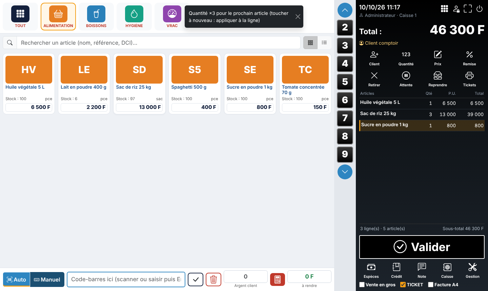

## Fonctionnalités

**Caisse (POS)** — écran tactile, clavier et douchette ; tuiles de catégories et d'articles
avec photo, stock et prix ; bande de quantité rapide 2–9 ; recherche instantanée ;
conditionnements (pack, carton) ; prix de gros ; promotions ; remises (ligne ou ticket) avec
seuil et autorisation d'un responsable ; paiements espèces / carte / mobile money / virement
et **paiement mixte** ; monnaie à rendre ; vente à crédit avec plafond ; mise en attente et
reprise ; tickets 58/80 mm et factures A4 (**3 modèles** chacun, **QR code** de vérification) ;
réimpression contrôlée (DUPLICATA) ; **Valider = encaissement espèces direct** sans fenêtre ;
opérateurs **mobile money** paramétrables ; anti-double validation ; raccourcis clavier
configurables ; plein écran.

**Devis et bons de livraison** — devis imprimables, suivi, conversion en vente ; bons de
livraison avec ou sans prix.

**Imprimantes** — plusieurs imprimantes thermiques (réseau ou USB partagée) pilotées par le
serveur : ticket de l'alimentation, bons de la cuisine, du bar… chacun sur la bonne imprimante.

**Articles** — fiches complètes (référence, code-barres, photo, catégorie/sous-catégorie,
marque, unité, prix d'achat/vente/gros/promo, seuil, fournisseur, lots, variantes,
informations pharmaceutiques) ; import/export CSV Excel ; étiquettes code-barres ;
génération de codes EAN-13 internes (bouton « Générer », création pour les articles sans code) ; modification groupée des prix ; historique des prix ;
détection des doublons ; archivage (jamais de suppression d'un article ayant un historique).

**Stocks** — multi-entrepôts ; mouvements tracés (date, utilisateur, motif, référence, solde) ;
ajustements, pertes, périmés ; transferts ; inventaires physiques ; lots et péremptions
(**FEFO**), alertes, rappels de lots et traçabilité des délivrances ; valorisation au
**coût moyen pondéré** ; stock négatif bloqué.

**TVA** — sans TVA, TVA générale au choix (articles exonérés) ou taux par article ; TVA
détaillée sur tickets et factures ; **rapport de TVA collectée** par taux et par mois.

**Achats** — fournisseurs ; bons de commande ; réceptions partielles/complètes avec frais
d'approche et choix du coût (**prix moyen, nouveau prix ou ancien prix**) et du nouveau prix de vente ; bons de réception ; retours fournisseurs ; dettes et paiements fournisseurs.

**Clients** — comptes, crédits, échéances, règlements et acomptes, reçus, relevés de compte,
fidélité (cumul de points).

**Finances** — sessions de caisse (fond, mouvements, clôture par coupures FCFA, écart) ;
dépenses et recettes diverses (contrepassation, pas de suppression) ; créances et dettes.

**Rapports & tableau de bord** — ventes du jour, tickets, panier moyen, marge, dépenses,
créances, dettes, espèces en caisse, valeur du stock, meilleures ventes, ruptures,
péremptions, graphiques ; rapports par période, boutique, catégorie, vendeur, caisse,
mode de paiement, heure ; bénéfice estimé ; stock dormant ; **export CSV et PDF** (PDF généré hors ligne).

**Restaurant** — plan de salle (tables, salles, terrasse), commandes sur place / à emporter /
livraison, envoi en cuisine avec bons par poste (cuisine, grill, bar), **écran cuisine**
en temps réel, annulations tracées avec perte, transfert et fusion de tables, addition et
**addition séparée**, fiches techniques (déstockage des ingrédients, coût matière),
rapport (couverts, serveurs, temps de préparation). Articles réservés au restaurant.
Rôles Serveur et Cuisinier.

**Pharmacie** — DCI, dosage, forme, présentation ; délivrance sur ordonnance réservée au
pharmacien ; registre des délivrances ; lots, FEFO, rappels. *(Conformité réglementaire à
faire valider par un professionnel : voir SECURITE.md.)*

**Modules complémentaires** — comme dans Odoo : déposer un module dans le dossier
`addons/` puis l'installer en un clic (Gestion → Modules complémentaires). Modules
fournis : **Pressing** (gestion complète d'un pressing) et « Livraisons » ; guide de création : [docs/MODULES.md](docs/MODULES.md).

**Administration** — utilisateurs, 11 rôles prédéfinis et **52 permissions** modifiables,
connexion par mot de passe, **PIN** ou badge RFID, journal d'audit, paramètres de
l'entreprise (logo, NIF, RCCM, pieds de ticket/facture), multi-boutiques, sauvegarde et
restauration vérifiées, assistant d'installation.

## Démarrage rapide

1. Copier le dossier dans `C:\wamp64\www\pos-wan`.
2. Créer une base MySQL `poswan` et un utilisateur dédié (phpMyAdmin).
3. Ouvrir `http://localhost/pos-wan/` → l'assistant d'installation se lance.

Guide complet : **[INSTALLATION_WAMPSERVER.md](INSTALLATION_WAMPSERVER.md)**
(hôte virtuel, imprimante thermique, douchette, sauvegardes planifiées, restauration,
mise à jour, dépannage).

Il n'existe **aucun compte par défaut** : l'identifiant et le mot de passe administrateur
sont choisis pendant l'installation.

## Documentation

| Document | Contenu |
|---|---|
| [INSTALLATION_WAMPSERVER.md](INSTALLATION_WAMPSERVER.md) | Installation, matériel, sécurisation, sauvegarde, restauration, mise à jour, dépannage |
| [SECURITE.md](SECURITE.md) | Mesures de sécurité, vérifications réalisées, risques résiduels |
| [docs/ARCHITECTURE.md](docs/ARCHITECTURE.md) | Structure du code, modèle de données, règles métier (CMP, FEFO, caisse, crédit) |
| [docs/GUIDE_UTILISATEUR.md](docs/GUIDE_UTILISATEUR.md) | Utilisation de la caisse et des modules |
| [docs/ETAT_DU_PROJET.md](docs/ETAT_DU_PROJET.md) | Ce qui est terminé, testé, et ce qui reste à faire |
| [docs/MODULES.md](docs/MODULES.md) | Ajouter / créer un module complémentaire |
| [CHANGELOG.md](CHANGELOG.md) | Historique des versions |

## Technique

PHP 8.1+ (testé en 8.3), MySQL 8 / MariaDB 10.4+ (testé en 10.11), Apache 2.4 (testé),
Bootstrap 5.3, Chart.js 4.4 — aucune dépendance à télécharger, aucun appel réseau externe.

```
php tests/run.php     # 95 tests automatisés (base de test dédiée, voir INSTALLATION § 13)
php bin/backup.php    # sauvegarde en ligne de commande (planifiable)
php bin/migrate.php   # mise à jour du schéma sans perte de données
```

## Captures

| Connexion | Menu de gestion |
|---|---|
| 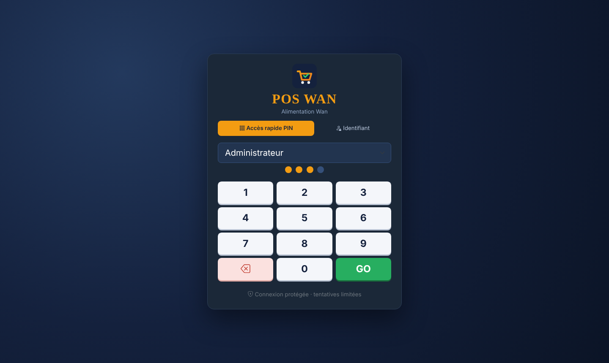 | 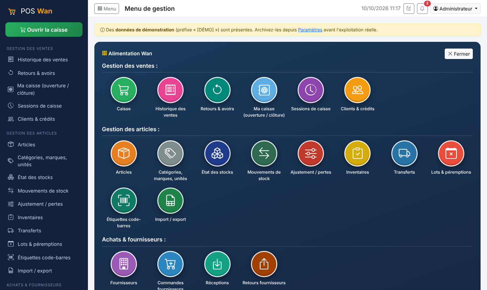 |

| Tableau de bord | Articles |
|---|---|
| 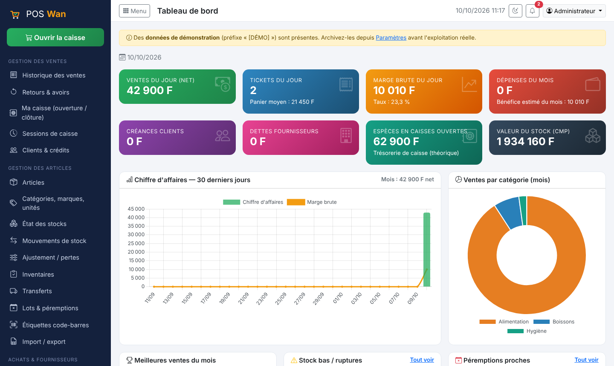 | 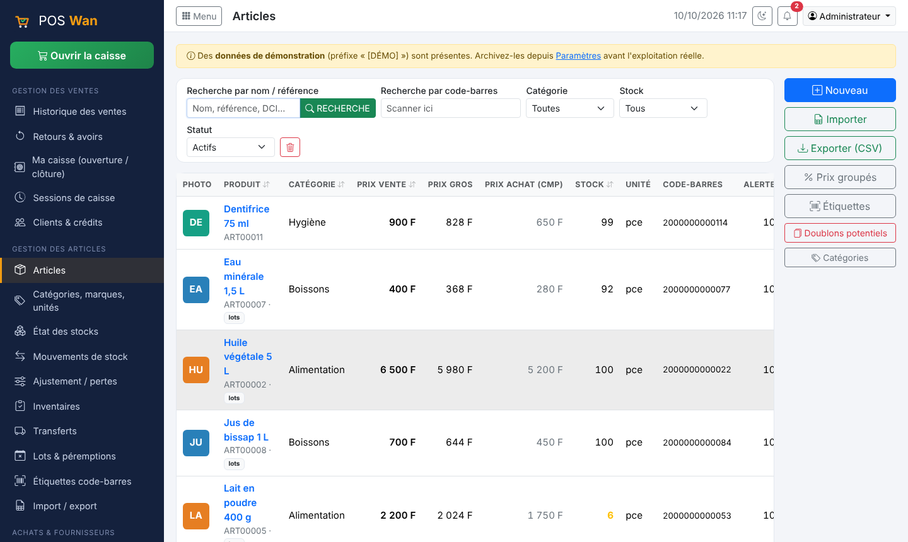 |

| Encaissement | Restaurant : plan de salle |
|---|---|
| 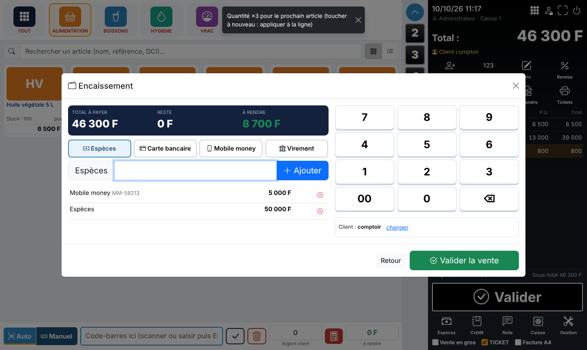 | 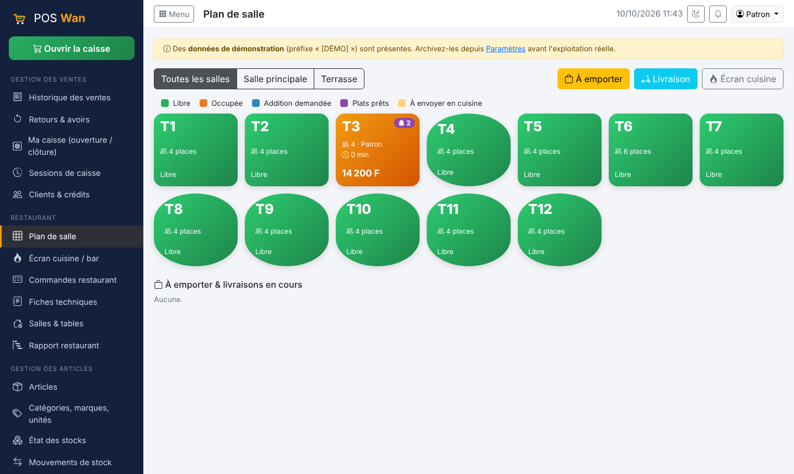 |

| Restaurant : prise de commande | Restaurant : écran cuisine |
|---|---|
| 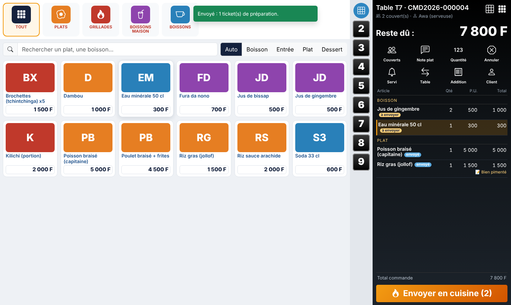 | 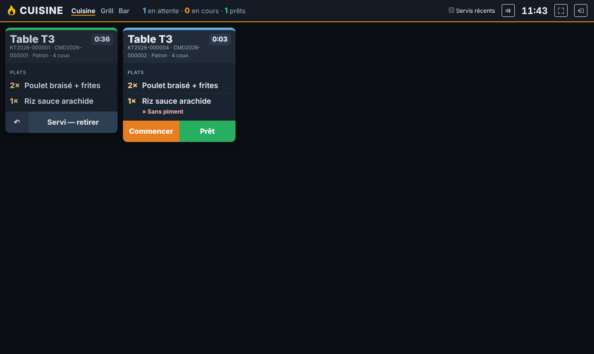 |

| Valider : encaissement direct | Encaissement mobile money |
|---|---|
| 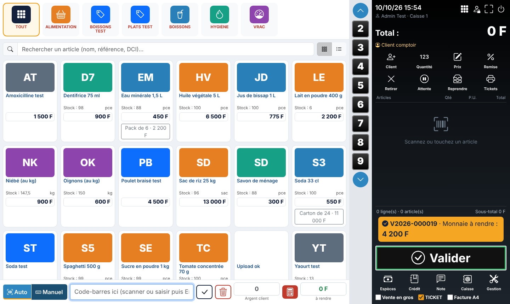 | 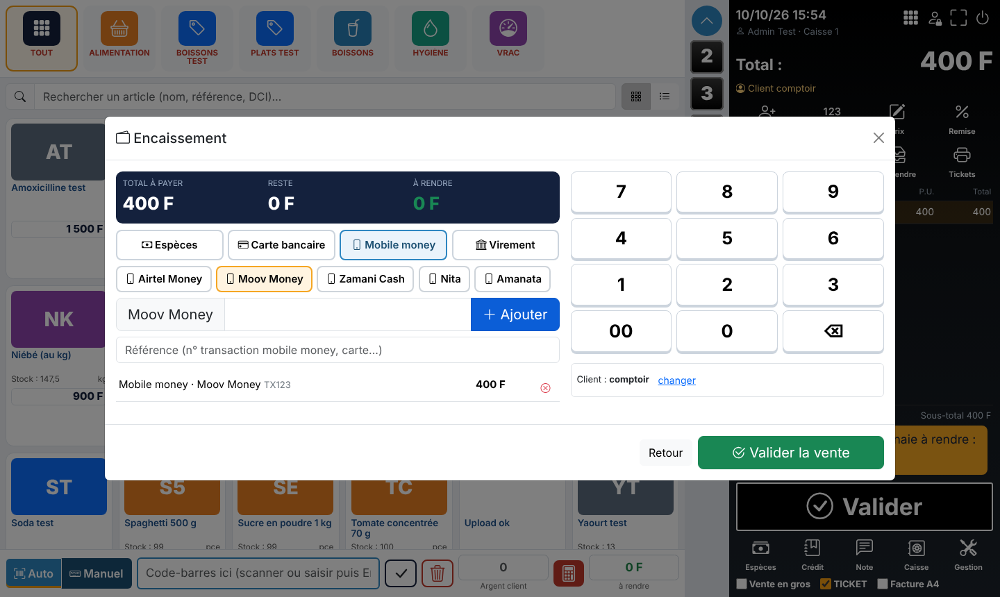 |

| Modèles de ticket (QR code) | Devis |
|---|---|
| 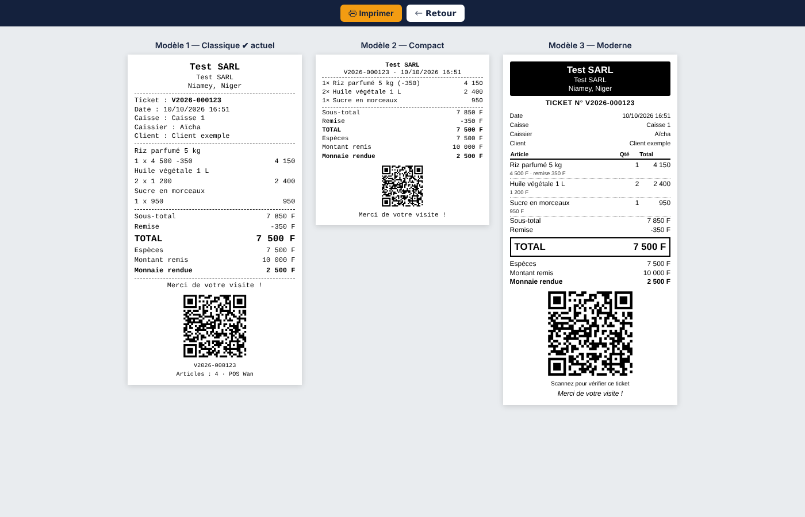 | 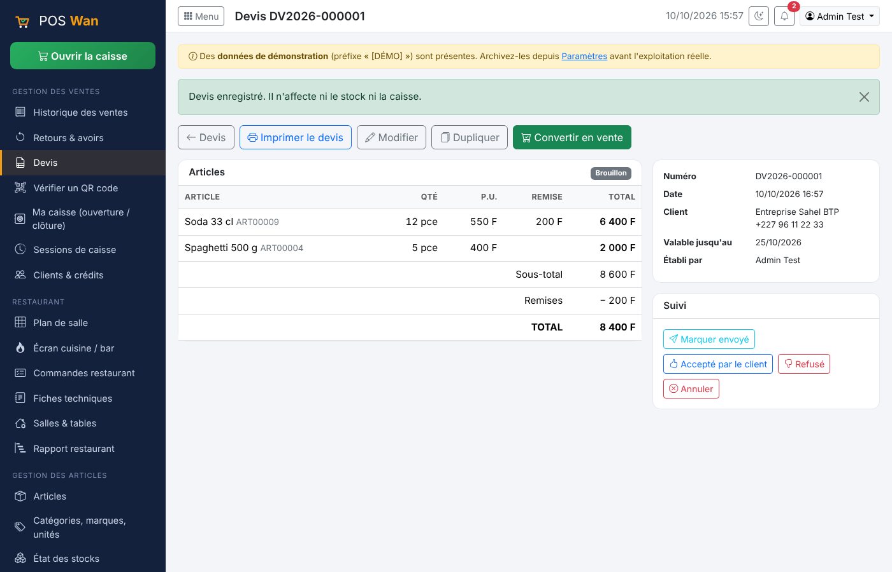 |

| Imprimantes | Caisse en arabe |
|---|---|
| 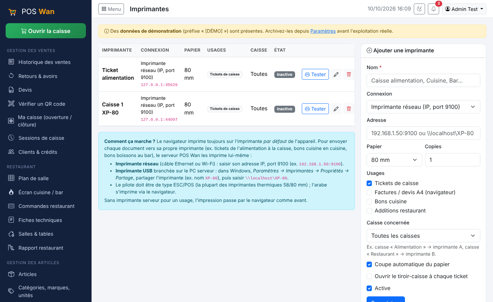 | 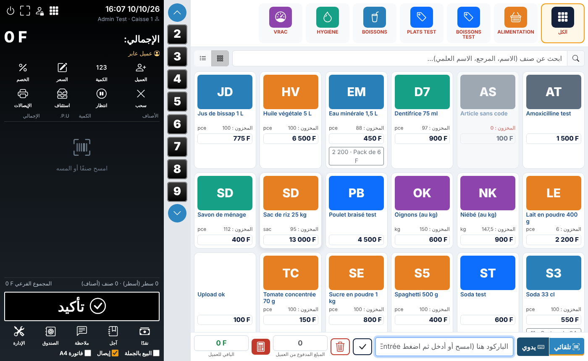 |

| Rapport TVA (CSV / PDF) | Écran cuisine |
|---|---|
| 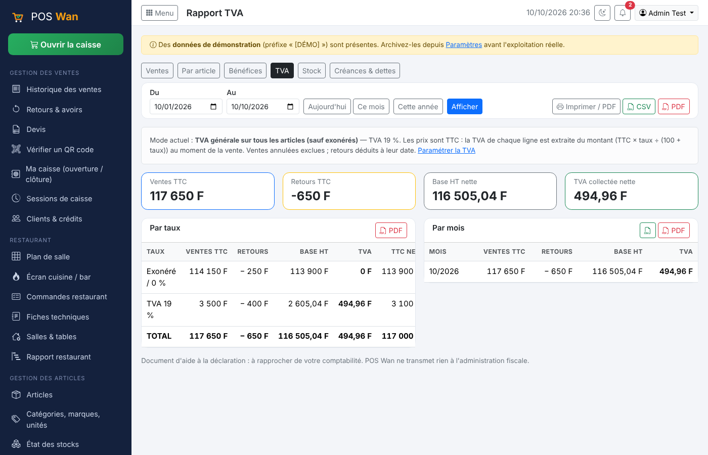 | 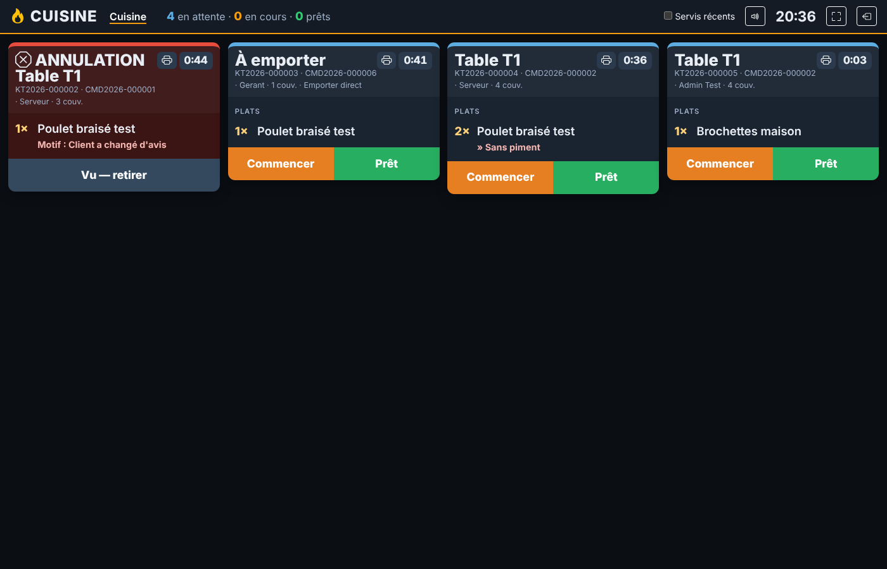 |
